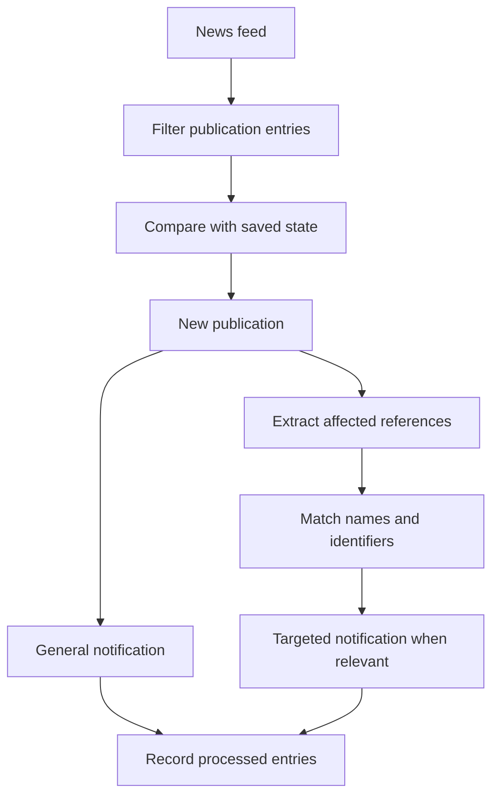

# EDQM Reference Monitor

> From publication announcements to a focused review queue.

[Portfolio](../README.md) | [Synthetic walkthrough](../examples/README.md#1-edqm-reference-monitor)

## Try the offline demonstration

The [reference-monitor demo](../demos/MONITOR.md) parses an invented local feed
and HTML table, matches a fictional interest list, and writes review candidates
and a processing checkpoint. It does not access EDQM or send notifications.
Unlike the operational workflow below, it tracks individual record versions
and uses an explicit previous-run checkpoint rather than a mutable shared state.

## Problem

Checking publication announcements and identifying relevant reference changes
involves repetitive browsing and comparison. An announcement can be new without
being relevant to a particular review scope.

## Workflow

The documented implementation monitors an EDQM news feed, filters
pharmacopoeia-related entries, and compares them with saved processing state.
For new entries, it sends a general notification, examines the linked publication
page, and extracts affected reference information where available.

Extracted names and identifiers are compared with an interest list. Relevant
matches produce a separate targeted notification, and processed entries are
recorded for subsequent runs.

## Engineering decisions

- **Separate discovery from relevance.** A general publication notification and
  a targeted match notification serve different review needs.
- **Match identifiers as well as names.** Structured identifiers offer an
  alternative when names vary.
- **Persist processing state.** Repeated collection does not need to mean
  repeated notification of the same entry.

## Review boundaries and limitations

A detected match is a prompt for assessment, not a determination of regulatory
impact. Source layout changes, incomplete extraction, and interest-list quality
can affect coverage. Saved state reduces repeat processing; it is not a claim
of exactly-once notification delivery or a validated audit trail.

Operation must respect source terms and access restrictions. This portfolio
does not reproduce source publications, operational watchlists, or session data.

## What this case study demonstrates

Feed-driven orchestration, structured extraction, relevance matching, persistent
state, and a distinction between informational and targeted notifications.
Implementation behavior is described from documentation, not independently
verified here.
