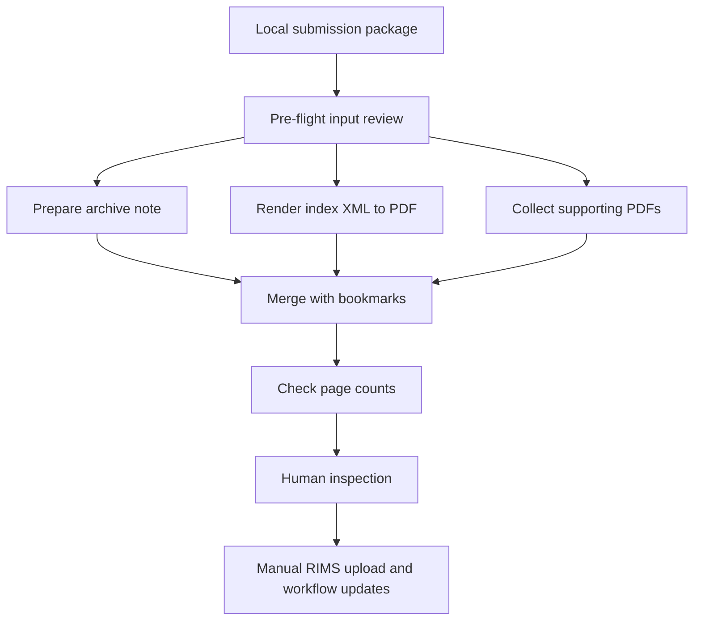

# RIMS Archive Preparation Assistant

> From a submission package to a navigable archive for manual upload.

[Portfolio](../README.md) | [Synthetic walkthrough](../examples/README.md#4-rims-archive-preparation-assistant)

## Problem

Preparing submission archives involves repetitive folder checks, supporting-note
creation, index rendering, PDF assembly, and output inspection. An archive also
needs to remain understandable to the person reviewing or retrieving it later.

## Workflow

The documented solution is an assisted archiving workflow, not an autonomous
RIMS integration. It checks local inputs, prepares an archiving note, renders
the submission index XML as a PDF, and assembles a bookmarked archive PDF.
The original XML is retained.

A page-count integrity check compares the assembled output with its component
documents. A reviewer inspects the result before manually uploading it and
performing any required tracking or workflow updates.

## Engineering decisions

- **Preserve the source index.** A rendered PDF complements rather than replaces
  the XML.
- **Make the archive navigable.** Bookmarks support review of an assembled PDF.
- **Check assembly integrity.** Page totals provide a focused check for missing
  or unexpected pages during merging.
- **Keep system actions explicit.** Archive preparation is distinct from upload,
  tracking updates, and workflow closure.

## Review boundaries and limitations

Equal page counts do not prove content correctness, correct document order,
legibility, valid signatures, or completeness of the source package. Rendered
forms and bookmarks still need inspection.

No direct RIMS API integration, automatic upload, or automatic workflow closure
is claimed. This portfolio includes no internal filing rules, access policies,
system screenshots, real packages, or operational instructions.

## What this case study demonstrates

Assisted document orchestration, XML rendering, PDF assembly, bookmark creation,
focused integrity checks, and an explicit handoff to manual system actions.
Implementation behavior is described from documentation, not independently
verified here.
